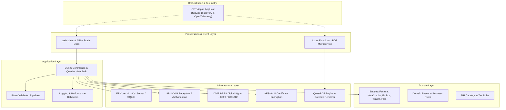

# BillingSaaS – Plataforma SaaS Multi-tenant de Facturación Electrónica (.NET 10 & Cloud Native)

<p align="left">
  <strong>Idioma / Language:</strong> 
  <a href="README.md">🇺🇸 English</a> | 
  <strong>🇪🇸 Español</strong>
</p>

[](https://dotnet.microsoft.com/)
[](https://docs.microsoft.com/en-us/dotnet/csharp/)
[](https://blog.cleancoder.com/uncle-bob/2012/08/13/the-clean-architecture.html)
[](https://learn.microsoft.com/dotnet/aspire/)
[](https://azure.microsoft.com/services/functions/)
[](tests/)

Plataforma empresarial multi-tenant desarrollada en **.NET 10** para la emisión, validación, firma digital criptográfica y autorización de comprobantes tributarios electrónicos (Facturas, Notas de Crédito, Notas de Débito) en cumplimiento con el **Servicio de Rentas Internas (SRI)** de Ecuador.

El proyecto está diseñado bajo principios de **Clean Architecture**, **CQRS (MediatR)**, observabilidad distribuida con **.NET Aspire / OpenTelemetry**, microservicios serverless en **Azure Functions** y un motor de cifrado simétrico autenticado **AES-GCM** para protección de certificados digitales en reposo.

🔗 **Documentación Interactiva de la API en Producción (Scalar):**  
👉 [https://facturafacil-gudhbdfpcagba9e5.westus2-01.azurewebsites.net/scalar/](https://facturafacil-gudhbdfpcagba9e5.westus2-01.azurewebsites.net/scalar/)

---

## 🏗️ Arquitectura del Sistema

El sistema implementa una arquitectura por capas desacoplada basada en Clean Architecture y Domain-Driven Design (DDD):



### Proyectos de la Solución

* **`src/Domain`**: Entidades centrales (`Factura`, `NotaCredito`, `NotaDebito`, `Emisor`, `Comprador`, `Tenant`, `TenantSubscription`, `Plan`), reglas de negocio de cálculo de impuestos (RIMPE, IVA con precisión de 6 decimales) y eventos de dominio.
* **`src/Application`**: Casos de uso implementados mediante CQRS con MediatR. Validaciones automáticas en pipeline con FluentValidation, mapeos y servicios de autorización multi-inquilino.
* **`src/Infrastructure`**: Acceso a datos con Entity Framework Core 10 (SQL Server y SQLite), interceptores de auditoría y despacho de eventos de dominio, integración SOAP con web services del SRI, generador y firmador digital **XAdES-BES** y servicio de cifrado **AES-GCM**.
* **`src/Web`**: Endpoints HTTP Minimal APIs optimizados, autenticación basada en Identity & Claims con soporte multi-tenant, y documentación interactiva moderna con **Scalar**.
* **`src/Functions`**: Microservicio serverless en **Azure Functions** aislado para la generación masiva de representaciones impresas (RIDE PDF) con QuestPDF y códigos de barra SVG.
* **`src/AppHost` & `src/ServiceDefaults`**: Orquestación cloud-native con **.NET Aspire**, integrando métricas, trazas distribuidas, health checks y resiliencia de red.

---

## 🚀 Características Principales

### 1. Facturación Electrónica Integral (SRI Ecuador)
* Generación de comprobantes XML según fichas técnicas oficiales (v1.1.0 / v1.0.0).
* Generación de clave de acceso de 49 dígitos con algoritmo Módulo 11.
* Firma digital electrónica en formato **XAdES-BES** utilizando certificados `.p12` / `.pfx` (`System.Security.Cryptography.Pkcs` / `Xml`).
* Consumo resiliente de web services SOAP de Recepción y Autorización del SRI.
* Generación de reportes PDF RIDE de alta fidelidad con códigos de barra y QR interactivo.

### 2. Multi-tenancy & Gestión de Suscripciones
* Aislamiento de datos por inquilino (`TenantId`).
* Control granular de planes (Básico, Emprendedor, Pro, Corporativo) y límites de emisión de comprobantes.
* Ciclo de vida y estados de inquilinos (`ACTIVO`, `SUSPENDIDO`, `VENCIDO`, `PERIODO_GRACIA`).
* Flujo de renovación y aprobación de solicitudes de suscripción.

### 3. Seguridad y Criptografía
* **Cifrado en reposo:** Certificados digitales `.p12` y contraseñas tributarias protegidos en base de datos mediante cifrado autenticado **AES-GCM (256-bit)**.
* **Aislamiento de Identidad:** Tokens JWT con claims de `TenantId` y roles (`Administrador`, `Partner`, `Cliente`).
* **Secret Management:** Gestión de secretos mediante User Secrets en desarrollo y variables de entorno / Azure Key Vault en producción.

### 4. Observabilidad y Resiliencia Cloud-Native
* Integración profunda con **.NET Aspire** y **OpenTelemetry** para trazas distribuidas entre el API y Azure Functions.
* Resiliencia HTTP (`Microsoft.Extensions.Http.Resilience`) con políticas de reintento ante caídas intermitentes de los web services gubernamentales del SRI.
* Health Checks automatizados para base de datos y endpoints de emisión.

---

## 🧪 Pruebas Automatizadas

La solución cuenta con una suite completa de pruebas automatizadas:

* **Domain Unit Tests**: Validación de invariantes de entidades, cálculo tributario y generación de clave de acceso.
* **Application Unit Tests**: Pruebas de casos de uso (Commands/Queries), validadores FluentValidation y mocks de servicios externos.
* **Infrastructure Integration Tests**: Pruebas de generadores XML, firma digital, cifrado AES-GCM y servicios SRI.
* **Functional API Tests**: Pruebas de integración de extremo a extremo con `WebApplicationFactory` y reseteo de base de datos con `Respawn`.

Para ejecutar las pruebas:

```bash
dotnet test
```

---

## 💻 Ejecución Local

### Prerrequisitos
* [.NET 10 SDK](https://dotnet.microsoft.com/download/dotnet/10.0)
* [Docker Desktop](https://www.docker.com/) (opcional, para ejecutar con contenedores mediante Aspire)

### Pasos para iniciar

1. **Clonar el repositorio:**
   ```bash
   git clone https://github.com/andress18/BillingSaaS.git
   cd BillingSaaS
   ```

2. **Restaurar paquetes y compilar:**
   ```bash
   dotnet build
   ```

3. **Ejecutar con .NET Aspire (Recomendado):**
   ```bash
   dotnet run --project src/AppHost
   ```
   El dashboard interactivo de Aspire se abrirá automáticamente en tu navegador mostrando las URLs activas, métricas y trazas en tiempo real.

4. **Acceder a la documentación de la API:**
   Una vez iniciada la aplicación Web, navega a:
   ```
   https://localhost:5001/scalar
   ```

---

## 🛠️ Stack Tecnológico

| Capa / Área | Tecnología |
| :--- | :--- |
| **Framework** | .NET 10 (C# 13) |
| **Arquitectura** | Clean Architecture, CQRS, DDD, Multi-tenancy |
| **Acceso a Datos** | Entity Framework Core 10, SQL Server, SQLite |
| **Patrón CQRS** | MediatR, FluentValidation |
| **Criptografía** | System.Security.Cryptography.Pkcs/Xml (XAdES-BES), AES-GCM 256 |
| **Documentos** | QuestPDF, Barcoder SVG |
| **Microservicios** | Azure Functions (Isolated Worker) |
| **Orquestación** | .NET Aspire (Hosting, Service Discovery, Health Checks) |
| **Observabilidad** | OpenTelemetry (Metrics, Traces, Exporters) |
| **Documentación** | Scalar (OpenAPI) |
| **Testing** | NUnit, Shouldly, Moq, Respawn, WebApplicationFactory |
| **CI/CD** | GitHub Actions (Azure Web Apps & Azure Functions) |
