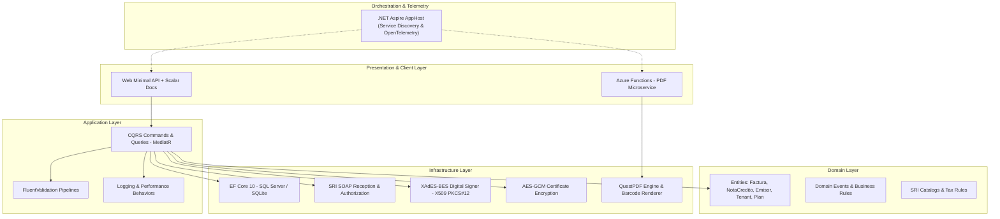

# BillingSaaS – Multi-tenant Cloud-Native Electronic Invoicing Platform (.NET 10)

<p align="left">
  <strong>Language / Idioma:</strong> 
  <strong>🇺🇸 English</strong> | 
  <a href="README.es.md">🇪🇸 Español</a>
</p>

[](https://dotnet.microsoft.com/)
[](https://docs.microsoft.com/en-us/dotnet/csharp/)
[](https://blog.cleancoder.com/uncle-bob/2012/08/13/the-clean-architecture.html)
[](https://learn.microsoft.com/dotnet/aspire/)
[](https://azure.microsoft.com/services/functions/)
[](tests/)

An enterprise-grade, cloud-native multi-tenant platform built with **.NET 10** for the generation, validation, cryptographic digital signing, and official authorization of electronic tax documents (Invoices, Credit Notes, Debit Notes) complying with the regulatory requirements of Ecuador's Internal Revenue Service (**SRI - Servicio de Rentas Internas**).

Architected following **Clean Architecture**, **CQRS with MediatR**, distributed observability with **.NET Aspire / OpenTelemetry**, serverless offloading via **Azure Functions**, and authenticated symmetric encryption (**AES-GCM 256-bit**) for securing digital certificates at rest.

🔗 **Live Production API Documentation (Scalar):**  
👉 [https://api.tributifico.com/scalar/](https://api.tributifico.com/scalar/)

---

## 🏗️ System Architecture

The solution implements a decoupled, layered architecture based on Clean Architecture and Domain-Driven Design (DDD):



### Solution Structure

* **`src/Domain`**: Core domain model (`Factura`, `NotaCredito`, `NotaDebito`, `Emisor`, `Comprador`, `Tenant`, `TenantSubscription`, `Plan`), tax calculation business rules (RIMPE tax regimes, VAT calculations with 6-decimal precision), and Domain Events.
* **`src/Application`**: Use cases implemented via CQRS with MediatR. Pipeline behaviors for FluentValidation, AutoMapper projections, and tenant authorization services.
* **`src/Infrastructure`**: Data access using Entity Framework Core 10 (SQL Server and SQLite support), automatic auditing and domain event dispatching interceptors, SRI SOAP web services integration, **XAdES-BES** digital signer, and **AES-GCM** encryption services.
* **`src/Web`**: High-performance Minimal API endpoints, ASP.NET Core Identity with Tenant Claims and Role-Based Access Control (RBAC), and interactive API documentation powered by **Scalar**.
* **`src/Functions`**: Serverless isolated worker microservice in **Azure Functions** for decoupled, high-throughput PDF generation (RIDE) using QuestPDF and Barcoder SVG.
* **`src/AppHost` & `src/ServiceDefaults`**: Cloud-native orchestration via **.NET Aspire**, managing service discovery, distributed health checks, and OpenTelemetry instrumentation.

---

## 🚀 Key Features

### 1. Comprehensive Electronic Invoicing (SRI Ecuador)
* Compliant XML invoice generation according to official government technical specifications (v1.1.0 / v1.0.0).
* 49-digit numerical access key (*Clave de Acceso*) generation with Modulo 11 check digit verification.
* **XAdES-BES** digital signature implementation using PKCS#12 (`.p12`/`.pfx`) certificates via `System.Security.Cryptography.Pkcs` and `Xml`.
* Resilient SOAP client integration with official SRI Reception and Authorization endpoints.
* High-fidelity RIDE (*Representación Impresa de Documento Electrónico*) PDF generation with dynamic barcodes and QR codes.

### 2. Multi-Tenancy & Subscription Management
* Strict data isolation by tenant identifier (`TenantId`).
* Tiered subscription plans (Basic, Entrepreneur, Pro, Corporate) with document emission quotas and tracking.
* Tenant lifecycle state machine (`ACTIVO`, `SUSPENDIDO`, `VENCIDO`, `PERIODO_GRACIA`).
* Self-service subscription renewal request and approval workflows.

### 3. Enterprise Security & Cryptography
* **Data Protection at Rest:** Sensitive tenant PKCS#12 certificates and tax passwords are encrypted in the database using authenticated symmetric encryption **AES-GCM (256-bit)**.
* **Identity & Access Management:** JWT tokens embedded with multi-tenant claims (`TenantId`) and role separation (`Administrador`, `Partner`, `Cliente`).
* **Secret Management:** Strict separation of environment configurations using .NET User Secrets in development and Azure Key Vault / Environment Variables in staging and production.

### 4. Cloud-Native Observability & Resilience
* End-to-end distributed tracing across API calls and serverless functions via **.NET Aspire** and **OpenTelemetry**.
* Transient fault handling and retry policies powered by `Microsoft.Extensions.Http.Resilience` for external government web services.
* Automated health checks for database connectivity and external service availability.

---

## 🧪 Automated Testing

The solution includes an extensive automated test suite with over **150 tests**:

* **Domain Unit Tests**: Verification of entity invariants, tax calculation precision, and access key algorithms.
* **Application Unit Tests**: CQRS command and query handler validation, FluentValidation pipeline rules, and external service mocking.
* **Infrastructure Integration Tests**: Real XML generation, digital signature verification, AES-GCM encryption/decryption, and SRI SOAP service tests.
* **Functional API Tests**: End-to-end HTTP integration tests leveraging `WebApplicationFactory` and database state resetting with `Respawn`.

To run the test suite:

```bash
dotnet test
```

---

## 💻 Local Development & Setup

### Prerequisites
* [.NET 10 SDK](https://dotnet.microsoft.com/download/dotnet/10.0)
* [Docker Desktop](https://www.docker.com/) (optional, for running containerized dependencies with Aspire)

### Getting Started

1. **Clone the repository:**
   ```bash
   git clone https://github.com/andress18/BillingSaaS.git
   cd BillingSaaS
   ```

2. **Restore dependencies and build:**
   ```bash
   dotnet build
   ```

3. **Run with .NET Aspire (Recommended):**
   ```bash
   dotnet run --project src/AppHost
   ```
   The interactive Aspire Dashboard will launch automatically in your default browser, providing real-time telemetry, service logs, and endpoint links.

4. **Access the API Documentation:**
   Once running, access the interactive Scalar API documentation at:
   ```
   https://localhost:5001/scalar
   ```

---

## 🛠️ Tech Stack & Libraries

| Layer / Concern | Technology |
| :--- | :--- |
| **Framework** | .NET 10 (C# 13) |
| **Architecture** | Clean Architecture, CQRS, DDD, Multi-tenancy |
| **Data Access** | Entity Framework Core 10, SQL Server, SQLite |
| **CQRS & Validation** | MediatR, FluentValidation |
| **Cryptography** | System.Security.Cryptography.Pkcs/Xml (XAdES-BES), AES-GCM 256-bit |
| **Reporting & Docs** | QuestPDF, Barcoder SVG |
| **Serverless** | Azure Functions (Isolated Worker Model) |
| **Orchestration** | .NET Aspire (Hosting, Service Discovery, Health Checks) |
| **Observability** | OpenTelemetry (Metrics, Traces, Structured Logs) |
| **API Documentation** | Scalar (OpenAPI) |
| **Testing** | NUnit, Shouldly, Moq, Respawn, WebApplicationFactory |
| **DevOps & CI/CD** | GitHub Actions (Azure Web Apps & Azure Functions) |
